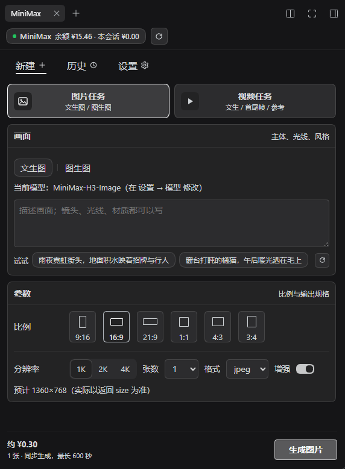

# dsh-minimax-h3

A MiniMax H3 workspace for DeepSeek Harness. It puts text-to-image, image
editing, text-to-video, first/last-frame video, and reference-to-video in one
right-sidebar tab, and exposes six agent tools for the same tasks.



## What you can do

- **New**: choose an image or video task, fill its own parameters, attach
  reference images, videos, or audio, preview them as thumbnails or waveforms,
  and submit without leaving the sidebar.
- **History**: filter by type or status, read dates and local cost estimates,
  open generated files, copy paths, open the containing folder, retry failed
  videos with their original source materials, and delete records with optional
  media cleanup.
- **Running videos**: check status automatically every seven seconds, show
  elapsed time and the last check, and stop auto-checking after 30 minutes.
- **Modify**: insert the task ID into the composer from History, then describe
  the change; the conversation agent can call the image edit or video reference
  tools with that context.
- **Settings**: MiniMax connection, default image/video models, interface
  language, local balance, and an alert threshold.

## Limits and data

- Image requests are synchronous and non-idempotent; they are never retried
  automatically, because a retry can be billed again.
- Video submission and download are separate; a failed download can be retried
  without submitting the generation again.
- Balances and prices are local estimates, not MiniMax's platform statement; an
  ordinary key cannot read the real balance.
- Prompts and reference media are sent to the configured MiniMax endpoint.
  Generated files, task records, pending references, and settings stay under
  `$DSH_HOME/plugins/dsh-minimax-h3` by default. The plugin has no telemetry of
  its own.
- The API key is read from the shared `MINIMAX_API_KEY` credential. Uninstalling
  keeps credentials, generated files, and task records.
- Menus support click-outside/Escape dismissal and keyboard arrow navigation.

## Requirements

- DeepSeek Harness 0.2.2 or newer, Web or Desktop.
- Node.js 24 or newer.
- A MiniMax API key.

## Install

Install the published package from **Plugins → Add plugin**, or add the
repository as a local bundle:

```text
Plugins → Add plugin → choose the dsh-minimax-h3 directory
```

After enabling it, open a session and use the MiniMax tab in the right sidebar.

## Data and privacy

- Prompts, reference images, reference videos, and reference audio are sent to
  the MiniMax API at the configured base URL when you submit a task.
- Generated files, task records, pending references, and local settings are
  stored under `$DSH_HOME/plugins/dsh-minimax-h3` by default.
- The plugin has no telemetry of its own. It does not send data anywhere except
  the configured MiniMax endpoint and the local DSH host.
- The API key is stored in the shared `MINIMAX_API_KEY` credential.
- Uninstalling the plugin does not delete the credential, generated files, or
  task records.
- Balance and cost figures are local estimates, not a MiniMax statement.

## Disclaimer

This is an unofficial plugin. It is not affiliated with or endorsed by MiniMax.
The MiniMax name and logo are used only to identify the upstream service; make
sure you have the right to redistribute any brand asset included here.

See `docs/DETAIL.md` for the feature image and the plugin description for
usage and limits.
