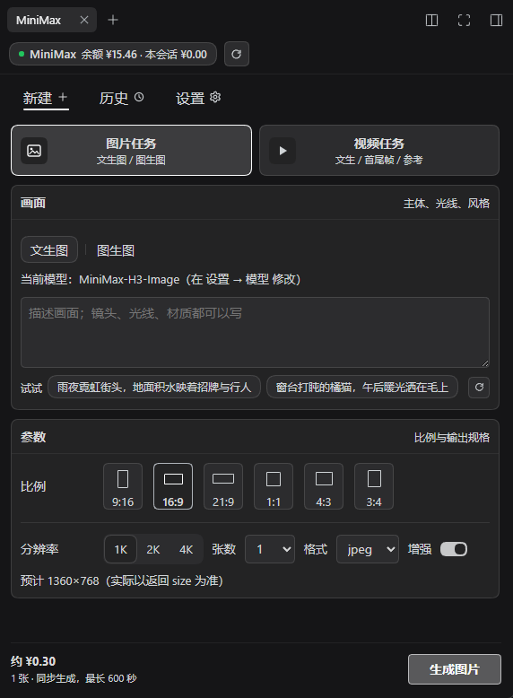

# dsh-minimax-h3

[English](README.md) | 中文

面向 DeepSeek Harness 的 MiniMax H3 工作台。它把文生图、图生图、文生视频、首尾帧视频和参考生视频收进一个右侧栏标签页，并提供六个对应的对话工具。



## 能做什么

- **新建**：选择图片或视频任务，填写各自参数，添加参考图、参考视频或参考音频，上传后直接看到缩略图或波形，在侧栏内提交。
- **历史**：按类型或状态筛选，查看日期和本地估算费用，打开生成文件、复制路径、打开所在文件夹，用原始素材重试失败视频，并可选择是否同时删除媒体文件。
- **运行中的视频**：每 7 秒自动查询状态，显示已等待时间和最近查询时间；30 分钟后停止自动查询。
- **修改**：在历史里点“修改”，把任务 ID 插入会话框，再描述修改要求；对话代理可以据此调用图片编辑或视频参考工具。
- **设置**：MiniMax 连接、默认图片/视频模型、界面语言、本地余额和预警阈值。

## 限制与数据

- 图片接口是同步且非幂等的，不会自动重试，因为重试可能重复计费。
- 视频提交与下载是分开的；下载失败可以只重试下载，不会重新提交生成。
- 余额和单价都是本地估算，不是 MiniMax 平台账单；普通 Key 无法读取真实余额。
- 提示词和参考素材会发送到配置的 MiniMax 地址。生成文件、任务记录、待处理参考和设置默认保存在 `$DSH_HOME/plugins/dsh-minimax-h3`。插件没有自己的遥测上报。
- API Key 从共享的 `MINIMAX_API_KEY` 凭据读取。卸载插件不会删除凭据、已生成文件和任务记录。
- 菜单支持点击外部/Esc 收起和键盘方向键导航。

## 环境要求

- DeepSeek Harness 0.2.2 或更新版本，Web 或 Desktop。
- Node.js 24 或更新版本。
- 一个 MiniMax API Key。

## 安装

从 **Plugins → Add plugin** 安装已发布的包，或把仓库作为本地 bundle 添加：

```text
Plugins → Add plugin → 选择 dsh-minimax-h3 目录
```

启用后，打开一个会话，在右侧栏使用 MiniMax 标签页。

## 数据与隐私

- 提交任务时，提示词、参考图、参考视频和参考音频会发送到配置的 MiniMax API 地址。
- 生成文件、任务记录、待处理参考和本地设置默认保存在 `$DSH_HOME/plugins/dsh-minimax-h3`。
- 插件没有自己的遥测；除了配置的 MiniMax 端点和本地 DSH Host，不会把数据发送到别处。
- API Key 保存在共享的 `MINIMAX_API_KEY` 凭据中。
- 卸载插件不会删除凭据、已生成文件或任务记录。
- 余额和费用是本地估算，不是 MiniMax 的账单。

## 免责声明

这是一个非官方插件，与 MiniMax 没有隶属或背书关系。MiniMax 名称仅用于说明上游服务；如仓库中包含品牌素材，请确认你拥有再分发权。

详情页见 `docs/DETAIL.zh.md`，使用说明和限制以插件描述为准。
